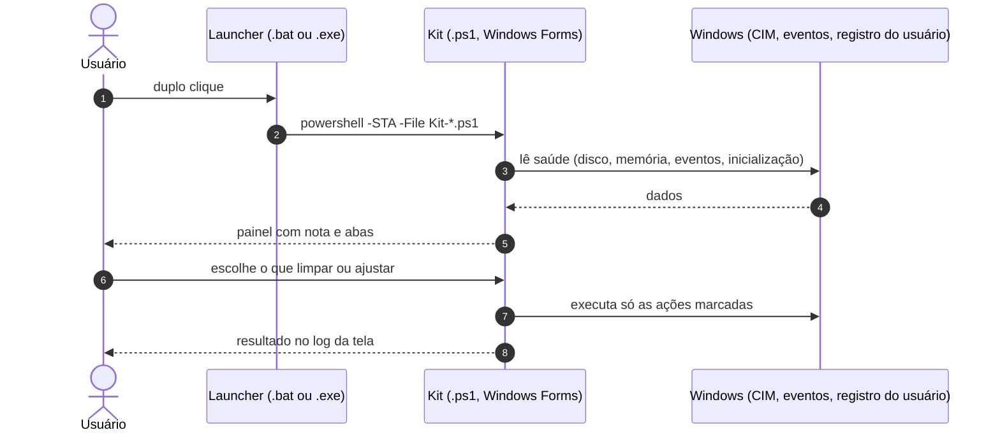
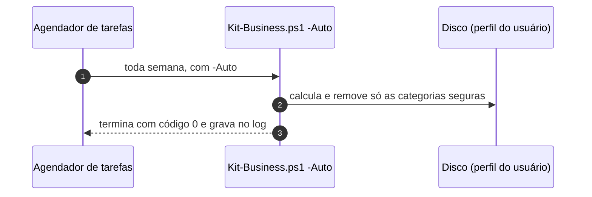
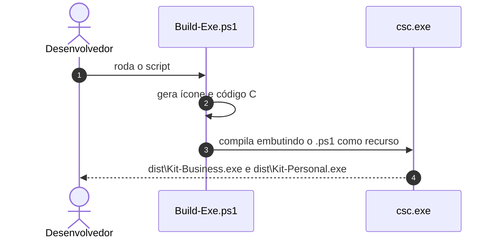

# Kits de Otimização do Windows

## Sumário

1. [Objetivo](#1-objetivo)
2. [Stack](#2-stack)
3. [Arquitetura](#3-arquitetura)
    - 3.1. [Diagrama de fluxo](#31-diagrama-de-fluxo)
    - 3.2. [Estrutura de diretório](#32-estrutura-de-diretório)
4. [Variáveis de ambiente](#4-variáveis-de-ambiente)
5. [Infraestrutura e deploy](#5-infraestrutura-e-deploy)
6. [Guia do desenvolvedor](#6-guia-do-desenvolvedor)

## 1. Objetivo

Dois utilitários de manutenção para Windows, em interface gráfica, escritos em PowerShell, **sem instalar nada e sem baixar nada**:

| Kit | Para quem | O que faz |
|---|---|---|
| **Kit Business** | PC corporativo (domínio/AD). Não pede administrador | Nota de saúde, "quem está travando" (eventos do Windows), limpeza só do perfil do usuário, memória e processos, itens de inicialização do usuário, revisão de Downloads antigos (vão para a Lixeira), teste de rede/VPN, relatório pronto para abrir chamado na TI e limpeza semanal agendada |
| **Kit Personal** | PC de casa / gamer | Painel de saúde com nota, Modo Jogo automático, limpeza, inicialização, teste de lag, monitor ao vivo (CPU/GPU), verificação do driver de vídeo e ajustes **reversíveis** com ponto de restauração |

Princípios de segurança:

- **Business:** não altera registro do sistema, serviços, Defender, políticas (GPO), VBS nem drivers.
- **Personal:** nunca toca em serviços críticos, Defender, VBS/HVCI, drivers nem na rede (TCP). Tudo que muda tem **Desfazer**.
- Cada kit grava o próprio log em `%APPDATA%`.

## 2. Stack

| Camada | Tecnologia |
|---|---|
| Linguagem | PowerShell 5.1 (já vem no Windows 10/11) |
| Interface | Windows Forms (`System.Windows.Forms` e `System.Drawing`) |
| Empacotamento | `csc.exe` (compilador C# do .NET Framework 4, que já vem no Windows): cada `.exe` embute o `.ps1` |
| Testes | Modo `-SmokeTest` de cada script (verificações internas e capturas de tela) |

## 3. Arquitetura

### 3.1. Diagrama de fluxo

Uso normal (duplo clique no `.bat` ou no `.exe`):



Limpeza semanal do Kit Business (tarefa agendada, sem janela):



Compilação do `.exe`:



### 3.2. Estrutura de diretório

```
Kit-Business.ps1    Kit para PC corporativo (interface, verificações, limpeza, agenda)
Kit-Business.bat    Atalho: abre o kit sem janela de console
Kit-Personal.ps1    Kit para PC de casa / gamer
Kit-Personal.bat    Atalho do Kit Personal
Build-Exe.ps1       Gera dist\*.exe com o csc.exe do Windows (a pasta dist\ não vai para o git)
```

## 4. Variáveis de ambiente

Os kits não usam variáveis de ambiente próprias. Parâmetros de linha de comando:

| Parâmetro | Kit | Efeito |
|---|---|---|
| `-SmokeTest` | os dois | Roda as verificações internas, usa uma pasta de dados temporária e não apaga nada de verdade |
| `-ShotDir <pasta>` | os dois | Salva capturas de tela de cada aba (usado no teste) |
| `-Auto` | Business | Executa a limpeza segura sem janela e sai (é o que a tarefa semanal chama) |

Arquivos que o programa cria:

| Caminho | Conteúdo |
|---|---|
| `%APPDATA%\KitBusiness\log.txt` e `%APPDATA%\KitPersonal\log.txt` | Log de tudo que o kit fez |
| `%APPDATA%\KitPersonal\config.json` | Lista de jogos, apps em segundo plano e opções do Modo Jogo |
| `%APPDATA%\KitPersonal\backup.json` | Valores originais do registro, para o **Desfazer** |

## 5. Infraestrutura e deploy

Não há servidor. A distribuição é copiar o `.exe` (da pasta `dist\`, gerada por você) ou o `.ps1` com o `.bat`. O `.exe` extrai o script para `%LOCALAPPDATA%\<Kit>\app` e abre sem janela de console. O `.bat` usa `-ExecutionPolicy Bypass` só para aquele processo, sem mudar a política da máquina.

## 6. Guia do desenvolvedor

```powershell
# rodar direto
powershell -NoProfile -ExecutionPolicy Bypass -STA -File .\Kit-Business.ps1

# teste interno (não apaga nada; grava capturas de tela)
powershell -NoProfile -ExecutionPolicy Bypass -STA -File .\Kit-Business.ps1 -SmokeTest -ShotDir .\capturas

# gerar os executáveis depois de editar um .ps1
powershell -ExecutionPolicy Bypass -File .\Build-Exe.ps1
```

Convenções:

- Toda ação que altera o sistema registra no log, e no Kit Personal tem desfazer.
- O Kit Business só mexe no que é do usuário logado (perfil, `HKCU`, Lixeira), para funcionar sem administrador e sem conflitar com políticas da empresa.
- Depois de mudar um `.ps1`, gere o `.exe` de novo: ele leva o script embutido.

## Licença

MIT. Veja o arquivo [LICENSE](LICENSE).
